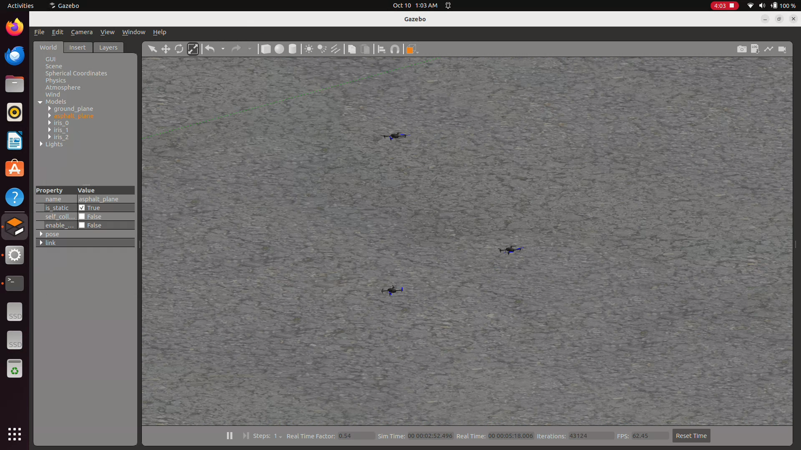
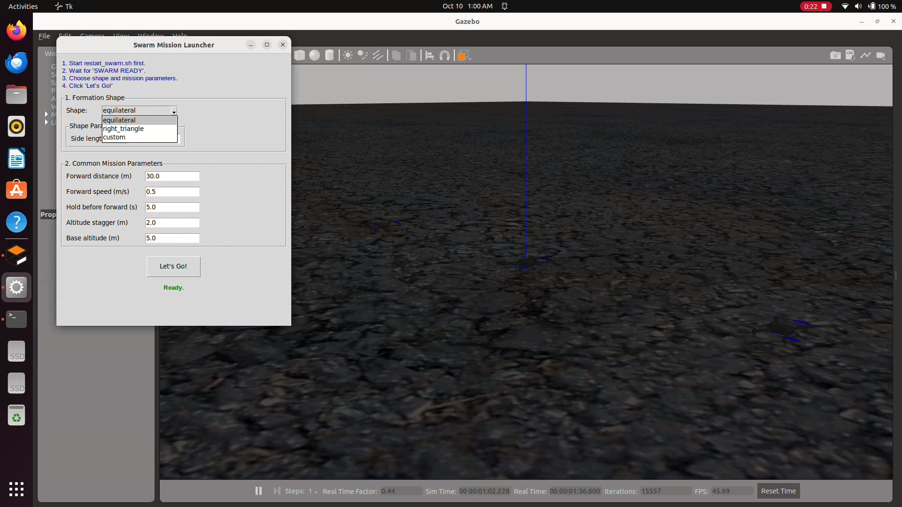

# 🚁 Multi-Drone Autonomous Swarm with GCS

[](LICENSE)
[](https://docs.ros.org/en/humble/)
[](https://px4.io/)
[](http://classic.gazebosim.org/)

A **Ground Control Station (GCS)-centric formation control system** for a three-drone autonomous quadrotor swarm, developed using PX4 v1.13.3 SITL, Gazebo Classic 11, and ROS 2 Humble with MAVROS 2.14.

The ground station streams **OFFBOARD position setpoints at 20 Hz**, while PX4 handles all inner control loops onboard.

---

## 📸 Demo Screenshots

| Gazebo Simulation | Tkinter Mission GUI |
|:---:|:---:|
|  |  |

---

## ✨ Key Features

- **Dynamic Formation Control:** Supports equilateral triangular, right-triangle, and custom formations through ROS 2 parameters or the GUI.
- **Coordinated Movement:** Enables synchronized forward translation while maintaining formation geometry.
- **Local-Frame Correction:** Automatically handles PX4 SITL multi-vehicle spawn offsets.
- **Collision Avoidance:** Parameter-gated potential-field repulsion layer (disabled by default).
- **Real-Time Fault Tolerance:** GCS-based fault detection for telemetry loss, in-air disarming, flight-mode dropout, and low battery, with configurable `abort_all` and `isolate_and_continue` policies.
- **Comprehensive Data Logging:** 10 Hz CSV state logging, capturing IMU, GPS, battery voltage, and mission-phase data for post-flight analysis.
- **Mission GUI:** Tkinter-based launcher for convenient parameter tuning and one-click mission execution.

---

## 🛠️ Tested Environment

| Component | Version |
|:---|:---|
| Operating System | Ubuntu 22.04 |
| ROS 2 | Humble |
| Gazebo | Classic 11.10.2 |
| PX4 Autopilot | v1.13.3 |
| MAVROS | 2.14.0 |
| Python | 3.10 |

---

## 📂 Repository Structure

```text
├── src/
│   └── swarm_ctrl/       # ROS 2 package
│       ├── controller    # Swarm formation controller
│       ├── GUI           # Mission GUI
│       ├── monitor       # Fault detection and monitoring
│       ├── setup.py
│       └── package.xml
│
├── scripts/
│   └── restart_swarm.sh  # Starts 3x PX4 SITL, Gazebo,
│                         # MAVROS, and PX4 parameters
│
├── docs/
│   ├── architecture      # System architecture
│   ├── ROS 2 topology    # ROS 2 communication topology
│   ├── fault_tolerance.md
│   └── version history
│
├── results/              # Validated flight logs (CSV)
│                         # and screenshots
│
├── LICENSE
├── CITATION.cff
└── README.md
```

---

## 📦 Setup & Installation

### 1. PX4 Autopilot (SITL)

Clone the PX4 repository and check out the required version:

```bash
git clone https://github.com/PX4/PX4-Autopilot.git --branch v1.13.3 --depth 1

cd PX4-Autopilot

bash ./Tools/setup/ubuntu.sh

make px4_sitl_default
```

### 2. ROS 2 Workspace

Create a ROS 2 workspace and copy the swarm controller package:

```bash
mkdir -p ~/swarm_ws/src

cp -r <this-repo>/src/swarm_ctrl ~/swarm_ws/src/

cd ~/swarm_ws

colcon build --packages-select swarm_ctrl

source install/setup.bash
```

### 3. Python Dependencies

Install the Python packages required for PX4 flight-log parsing and MAVLink communication:

```bash
pip3 install --user pymavlink pyulog
```

---

## 🚀 How to Run

The system requires a specific startup sequence to ensure that all PX4 instances and MAVROS connections are established correctly.

### 1. Start the Swarm Simulation

From the repository root, execute:

```bash
./scripts/restart_swarm.sh
```

**⚠️ Important:** Wait until you see:

```text
[INFO] ... SWARM READY
```

Make sure all three drones report:

```text
connected: true
```

### 2. Launch the Controller

In a second terminal:

```bash
source ~/swarm_ws/install/setup.bash

ros2 run swarm_ctrl gui_launcher
```

This launches the Tkinter mission GUI, allowing you to configure and execute missions.

### Alternative: Command-Line Execution

You can also launch the swarm controller directly through ROS 2:

```bash
ros2 run swarm_ctrl swarm_controller --ros-args \
-p formation_shape:=equilateral \
-p forward_distance_m:=30.0 \
-p fault_policy:=isolate_and_continue
```

---

## 🧪 Fault Tolerance — Validated SITL Results

The swarm implements real-time fault detection and handling at the Ground Control Station (GCS) level. Four fault scenarios (F1–F4) have been tested in PX4 SITL to validate the system's ability to detect failures, isolate faulty drones, and maintain mission continuity when possible.

### ⚠️ Test Execution Requirements

For **F1, F2, and F3**, execute the injection commands during an active mission:

1. **Terminal 1:** Start the simulation using `restart_swarm.sh`.
2. **Terminal 2:** Launch the swarm controller.
3. Wait until all drones are airborne and the controller begins forward translation.
4. Look for a log message similar to:

   ```text
   [INFO] [...] FORWARD | offset=10.15/30.00 m
   ```

5. **Terminal 3:** Execute the corresponding fault-injection command.

For ROS 2 service calls, ensure Terminal 3 has the ROS 2 environment sourced:

```bash
source ~/swarm_ws/install/setup.bash
```

### Fault Injection Tests

| Test ID | Fault Scenario | Injection Method | Expected Detection & Response |
|:---:|:---|:---|:---|
| F1 | **Telemetry Loss** | Kill Drone 1's PX4 flight-controller process using `pkill -9 -f "px4.\*-i 1"` | GCS loses Drone 1's heartbeat/telemetry and detects the failure. Drone 1 is isolated; Drones 0 and 2 continue the mission. |
| F2 | **Mode Dropout** | Force Drone 1 out of OFFBOARD using the `/drone1/set_mode` ROS 2 service with `AUTO.LOITER`. | `mode_sent: True`. GCS detects `MODE_DROPOUT` after a 2-second grace period. Drone 1 is isolated; remaining drones continue. |
| F3 | **In-Air Disarm** | Disarm Drone 1 during flight using the `/drone1/cmd/arming` ROS 2 service. | `success: True`. GCS immediately detects `IN_AIR_DISARM`. Drone 1 falls in Gazebo; Drones 0 and 2 continue the mission. |
| F4 | **Low Battery** | Start the controller with an artificially high battery threshold (`100.0 V`). | Within 1–2 seconds of takeoff, GCS detects `BATTERY_LOW` for all drones. Drones are isolated or the mission is aborted according to the configured policy. |

---

### F1: Telemetry Loss — Kill Drone 1's Flight Controller

**Objective:** Simulate a total flight-controller failure or loss of communication with Drone 1. The GCS should lose its heartbeat and detect the telemetry failure.

**Terminal 3 — Injection Command:**

```bash
pkill -9 -f "px4.\*-i 1"
```

**Alternative:** If the PX4 process naming convention in `restart_swarm.sh` differs and the above command does not work, terminate Drone 1's MAVROS bridge instead:

```bash
pkill -9 -f "mavros.*drone1"
```

**Expected Result:**
- GCS detects the loss of Drone 1's telemetry.
- Drone 1 is isolated.
- Drones 0 and 2 continue the remaining mission and complete the 30 m forward path.

*Note: Killing the MAVROS bridge tests loss of the GCS communication path, whereas killing PX4 terminates the flight-controller process itself.*

### F2: Mode Dropout — Force Drone 1 Out of OFFBOARD

**Objective:** Simulate an internal PX4 failsafe or flight-mode change that causes Drone 1 to leave OFFBOARD control.

**Terminal 3 — Injection Command:**

```bash
ros2 service call /drone1/set_mode mavros_msgs/srv/SetMode "{custom_mode: 'AUTO.LOITER'}"
```

**Expected Terminal 3 Response:**

```text
mode_sent: True
```

**Expected Terminal 2 Response:**

```text
FAULT DETECTED: drone1 - MODE_DROPOUT
```

Detection occurs after the configured **2-second grace period**.

**Expected Result:**
- GCS detects Drone 1's departure from OFFBOARD mode.
- Drone 1 is isolated.
- Drones 0 and 2 continue the mission.

### F3: In-Air Disarm — Cut Drone 1's Motors

**Objective:** Simulate a catastrophic hardware failure or accidental arming-switch operation that disarms Drone 1 during flight.

**Terminal 3 — Injection Command:**

```bash
ros2 service call /drone1/cmd/arming mavros_msgs/srv/CommandBool "{value: false}"
```

**Expected Terminal 3 Response:**

```text
success: True
```

**Expected Terminal 2 Response:**

```text
FAULT DETECTED: drone1 - IN_AIR_DISARM
```

Detection should occur immediately.

**Expected Result:**
- Drone 1 is disarmed and falls in Gazebo.
- GCS immediately identifies the in-air disarm condition.
- Drone 1 is isolated.
- Drones 0 and 2 continue the mission.

### F4: Low Battery — Artificially High Threshold

**Objective:** Validate GCS low-battery detection without manually draining the PX4 SITL battery.

PX4 SITL does not provide a straightforward external battery-draining mechanism through the ROS 2 services used in this project. Instead, the GCS low-battery logic is tested by setting an artificially high battery threshold.

A threshold of **100 V** is used because it is significantly higher than a typical LiPo battery voltage. Consequently, every drone should be identified as having low battery as soon as valid battery telemetry is received.

**Important:** Unlike F1–F3, this is a startup-time test, not a mid-flight injection.

**Terminal 2 — Start the Controller with the Test Threshold:**

Use the following command instead of the normal GUI launch or standard controller command:

```bash
source ~/swarm_ws/install/setup.bash

ros2 run swarm_ctrl swarm_controller --ros-args \
  -p formation_shape:=equilateral \
  -p forward_distance_m:=30.0 \
  -p forward_speed_mps:=0.5 \
  -p fault_policy:=isolate_and_continue \
  -p battery_low_threshold_v:=100.0
```

**Expected Terminal 2 Response:**

Within approximately 1–2 seconds of takeoff, the GCS should report:

```text
FAULT DETECTED: drone0 - BATTERY_LOW
FAULT DETECTED: drone1 - BATTERY_LOW
FAULT DETECTED: drone2 - BATTERY_LOW
```

**Expected Result:**
- All three drones are flagged for low battery.
- The configured `isolate_and_continue` policy is applied.
- Each faulty drone is handled according to the configured fault-handling logic.

---

### Fault-Handling Policies

The GCS supports two fault-handling policies:

| Policy | Behavior |
|:---|:---|
| `abort_all` | Aborts the entire swarm mission when a fault is detected. |
| `isolate_and_continue` | Isolates the faulty drone and allows the remaining healthy drones to continue the mission. |

The fault-tolerance system is designed to prevent a single drone failure from unnecessarily compromising the entire swarm mission.

**Detailed implementation, fault-injection procedures, and architectural information:**

📄 [`docs/fault_tolerance.md`](docs/fault_tolerance.md)

**Validation Status:** All four fault scenarios have been tested in PX4 SITL. Physical hardware testing remains pending.

## 📜 Version History & Evolution

This repository preserves the project's development history through Git tags. Each milestone introduced specific features and documented the limitations present at that stage, which were addressed in subsequent iterations.

Tags `v0.1`–`v0.6` are byte-exact snapshots of the private development archives. `v1.0.0` represents the current validated release.

| Tag | Milestone | Features Added | Known Limitations (at the time) |
|:---:|:---|:---|:---|
| `v0.1` | **Takeoff & Formation** | Synchronized takeoff of three drones and static triangular formation holding. | Drones could not move; no forward translation. |
| `v0.2` | **Forward Translation** | Coordinated forward movement; fixed local-frame spawn offset bugs. | Right-triangle shape geometry was mathematically broken. |
| `v0.3` | **GUI Launcher** | Added Tkinter GUI for easy parameter tuning and mission launching. | Shape was hardcoded; users could not dynamically select formations. |
| `v0.4` | **Shape Selection** | Dynamic shape selection (Equilateral, Right, Custom) through GUI/CLI. | Drones could crash into each other if custom offsets were too tight. |
| `v0.6` | **Collision Avoidance** | Added a potential-field repulsion layer (Hu et al. 2025) to prevent crashes. | No fault tolerance; if a drone died, the whole mission failed. |
| `v1.0.0` | **Fault Tolerance** | **Current Release.** GCS fault detection (D1–D4), `isolate/abort` policies, and comprehensive CSV logging. | Fully validated in SITL. Physical hardware testing pending. |

---

## 📚 Documentation

Additional project documentation and technical details are available in the repository:

- **System Architecture:** Overall system design and component interactions.
- **ROS 2 Topology:** Node structure and communication architecture.
- **Fault Tolerance:** Fault detection, isolation, and mission-abort mechanisms.
- **Version History:** Development milestones and feature evolution.

---

## © Copyright & Attribution

Copyright (c) 2026 Muhammad Nouman.

Released under the **MIT License**. See [`LICENSE`](LICENSE) for details.

**Attribution Required:** Retain the copyright notice and provide appropriate citation using [`CITATION.cff`](CITATION.cff).

---

## 🧩 Acknowledgments

- **PX4 Autopilot & MAVROS:** For providing the flight-control stack and ROS 2 communication bridge.
- **MDS (MAVSDK Drone Show):** For inspiring the GCS-centric architecture.
- **Hu et al. (IEEE TAES, 2025):** For the mathematical formulation inspiring the potential-field collision-avoidance approach.

---
